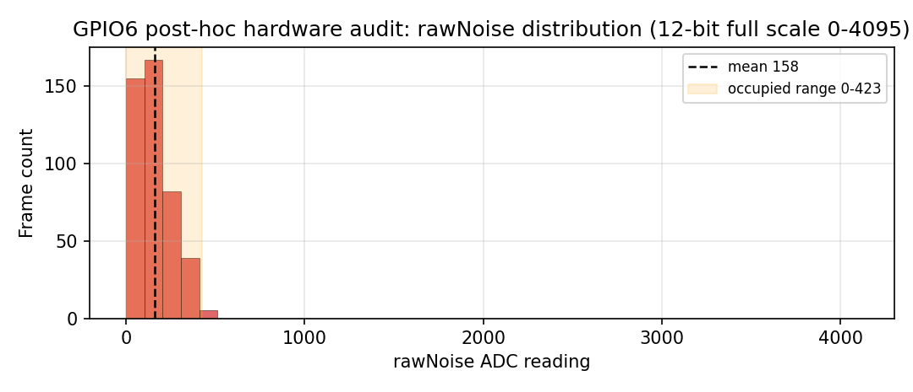
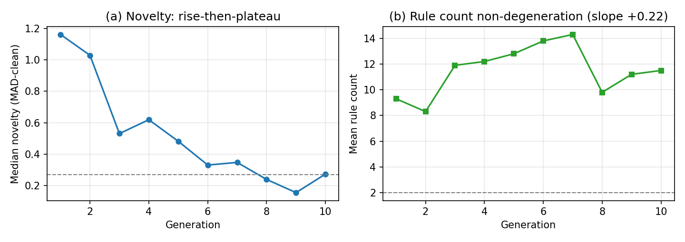
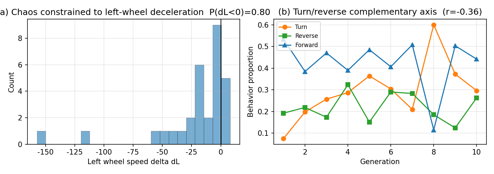

# Embodied Evolution Car

**The Physical Riverbed Hypothesis** — an open experimental platform and dataset for studying how the physical body of a robot constrains and shapes the trajectory of open-ended behavioral evolution.

This repository accompanies the paper:

> *The Physical Riverbed Hypothesis: Structural Boundaries and Cross-Hardware Validation of an Embodied Evolution System under Extreme Constraints*

[arXiv preprint](#) · [Paper (LaTeX)](paper/main.tex) · [Figures](figures/)

---

## Overview

The project is a minimal, "three-no" (no-calibration, no-filtering, no-PID) **obstacle-escape robot** driven by **novelty search**. It was built entirely by a single developer in three months, across two heterogeneous ESP32 hardware platforms, deliberately consuming raw hardware thermal noise as a system input. Because the hardware and firmware were never frozen into a static lab setup, the development history itself became a *natural variation test* for the conjecture that **physical structure acts as an algorithm** — a "physical riverbed" that anchors behavior through epistatic effects rather than a rigid rope that directly drives it.

## Key Claims

1. **Structural signatures are cross-hardware stable.** Novelty "rise-then-plateau", non-degenerating rule count, and chaos constrained to left-wheel deceleration reproduce across two hardware forms and multiple firmware versions.
2. **The weak hypothesis is falsified.** "Specific sensor parameters directly determine specific behaviors" collapses to a *Simpson pseudo-correlation* once environmental confounds are removed.
3. **Boundary:** when perceptual information bandwidth is degraded and the noise pin is polluted by on-chip Flash multiplexing, diversity survives but the speed–survival capability pricing becomes non-computable.

## Figures

The paper's core visual evidence, all from configuration B (N16R8 + TCRT5000):

1. **Noise-source audit** — post-hoc hardware audit of the GPIO6 noise pin: the reading is clamped to the low band 0–423, not full-scale thermal noise, evidencing Flash-multiplexing pollution of the "floating" noise source.



2. **Novelty & rule count** — novelty "rise-then-plateau" and a non-degenerating rule count.



3. **Chaos anchoring** — left-wheel deceleration and the turn/reverse complementary axis.



## Hardware

| | Config A (baseline) | Config B (extended) |
|---|---|---|
| MCU | ESP32-S3-M-4M | ESP32-S3-N16R8 (16 MB Flash + 8 MB PSRAM) |
| Filesystem | SPIFFS (EXSIMP) | FFat (later) |
| Sensor | Sharp GP2Y0A21YK0F | TCRT5000 reflective (AO) |
| Noise pin | GPIO6 (floating) | GPIO6 (Flash-multiplexed) |
| Motor driver | DRV8833 | L298N |

## Repository Layout

```
embodied-evolution-car/
├── paper/            # paper/main.tex (English LaTeX) + manuscript_zh.docx (Chinese)
├── figures/          # PDF/PNG figures used in the paper
├── scripts/          # figure-generation scripts
├── firmware/         # ESP32 firmware (see firmware/README.md)
├── data/             # Experimental datasets (see data/README.md)
├── init_repo.ps1     # one-shot git init + first commit helper
├── LICENSE
└── README.md
```

## Citation

If you use this work, please cite the accompanying paper (bibtex entry will be added once the arXiv ID is available):

```bibtex
@article{physcalcar2026,
  title   = {The Physical Riverbed Hypothesis: Structural Boundaries and Cross-Hardware Validation of an Embodied Evolution System under Extreme Constraints},
  author  = {Cai, Jiyong},
  year    = {2026},
  note    = {arXiv preprint}
}
```

## Getting Started

1. Read [`paper/main.tex`](paper/main.tex) for the full argument and results.
2. Re-generate the figures with `python scripts/generate_figs_en.py`.
3. Firmware and raw data are documented in [`firmware/README.md`](firmware/README.md) and [`data/README.md`](data/README.md) respectively.

## Submitting to arXiv

arXiv requires the TeX source, not a rendered PDF. Build the submission bundle with:

```bash
python scripts/build_arxiv_package.py
```

This writes `build/arxiv/arxiv_submission.tar.gz`, containing `main.tex` at the archive root and the three figures under `figures/`. The script also validates the bundle against arXiv's automatic-processing failure modes (non-relative paths, `\include`, unresolvable figures, dangling `\ref`, leftover TeX comments, Type 3 fonts) and aborts if any check fails.

Two source-level conventions exist for arXiv compatibility and are enforced by the build:

- `paper/main.tex` locates figures via `\graphicspath{{../figures/}{figures/}{}}` so the paper compiles in place; the bundle rewrites this to `{{figures/}{}}`, since arXiv extracts the archive to a flat directory and `../` paths do not resolve.
- Figures are generated with `pdf.fonttype = 42` (embedded TrueType). Matplotlib's default Type 3 fonts are rejected by arXiv's PDF pipeline.

## License

[MIT](LICENSE) unless otherwise noted. Experimental data may carry its own terms — see [`data/README.md`](data/README.md).